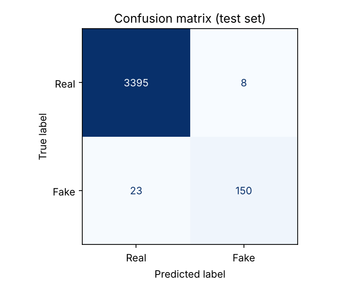
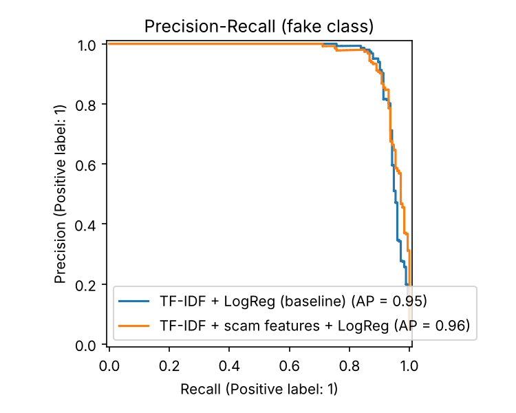

# 🕵️ Fake Job Posting Detector

An NLP model that flags scam job and internship listings and **explains why**, wrapped in a Streamlit app.

**Live demo:** _add your Hugging Face Spaces link here after deploying_

## The problem

Fake job posts steal money (fake "registration fees"), personal documents, and time, and students and freshers are the main targets. Most people can't tell a scam from a real post at a glance. This project scores a posting for scam risk and shows the specific red flags behind the score, so a user learns *what to look for*, not just a yes/no.

## Dataset

[EMSCAD "Real / Fake Job Posting Prediction"](https://www.kaggle.com/datasets/shivamb/real-or-fake-fake-jobposting-prediction): 17,880 postings, of which **866 (4.8%) are fraudulent**. That 95:5 class imbalance is the main challenge:

- plain accuracy is meaningless (predicting "real" every time gives 95%), so I report **precision, recall, F1 and PR-AUC on the fake class**
- the loss is class-weighted (`class_weight="balanced"`)
- the decision threshold is tuned with cross-validation on the **training set only**, so the test set stays untouched

## Approach

1. **Clean**: merge title, company profile, description, requirements and benefits into one text field; strip HTML, URLs, emails, phone numbers, punctuation
2. **Text features**: TF-IDF on unigrams + bigrams (60k features, sublinear TF)
3. **Scam-signal features**: missing company profile / logo / requirements / salary, urgency language, earning promises, "no experience needed" claims, ALL-CAPS ratio, exclamation marks, number of empty fields
4. **Model**: Logistic Regression (class-weighted). Chosen on purpose: it is fast, strong on sparse text, and **exactly explainable**
5. **Explainability**: for a linear model, `coefficient × feature value` is an exact breakdown of the log-odds, so the app shows which words and signals pushed the score up or down without needing LIME/SHAP sampling
6. **Rule layer** (not learned): the public dataset anonymises emails and URLs, so the model can't learn "Gmail contact" or "asks for a fee". The app adds rule-based checks for free-email domains, upfront fees, WhatsApp/Telegram redirects, and pressure language

## Results

20% stratified hold-out (3,576 postings, 173 fake), threshold tuned on train-set cross-validation:

| Model | Precision | Recall | F1 | PR-AUC |
|---|---|---|---|---|
| TF-IDF + LogReg (baseline) | 0.951 | 0.896 | 0.923 | 0.952 |
| TF-IDF + scam features + LogReg (shipped) | 0.949 | 0.867 | 0.906 | 0.959 |

 

**Honest reading:** both models land around 0.91 to 0.92 F1. With only 173 fake posts in the test set, the gap between them is a handful of postings, so it is within noise. The scam-features model has the higher PR-AUC (a threshold-independent measure) and powers the explanations, which is why it ships. Words the model leans on for "fake" include data entry, administrative, earn and money; for "real", software, client, team and university.

**Limitations:** the dataset is English-language and dates from the early 2010s, so newer scam styles (Telegram task scams, crypto) are underrepresented; the model is a screening aid, not proof.

## Run it

```bash
git clone https://github.com/darshangn169-beep/fake-job-detector.git
cd fake-job-detector
pip install -r requirements.txt

# put fake_job_postings.csv from Kaggle into data/
python train.py          # trains, evaluates, saves models/model.joblib (~2 min on CPU)
streamlit run app.py     # launches the web app
```

A pre-trained `models/model.joblib` is included, so you can run the app without retraining.

### Optional: DistilBERT comparison

`train_bert.py` fine-tunes DistilBERT on the same split (use a free Colab T4 GPU). Run it and add its row to the table above.

### Deploy on Hugging Face Spaces (free)

1. Create a new Space, choose **Streamlit** as the SDK
2. Upload `app.py`, `jobscam.py`, `requirements.txt` and `models/model.joblib`
3. Copy the Space URL into the top of this README

## Project structure

```
app.py            Streamlit app
jobscam.py        cleaning, features, pipeline, explanations (shared by train + app)
train.py          training + evaluation + figures
train_bert.py     optional DistilBERT comparison (Colab)
models/           saved model + metrics.json
figures/          confusion matrix, PR curve
results.md        auto-generated results
```
